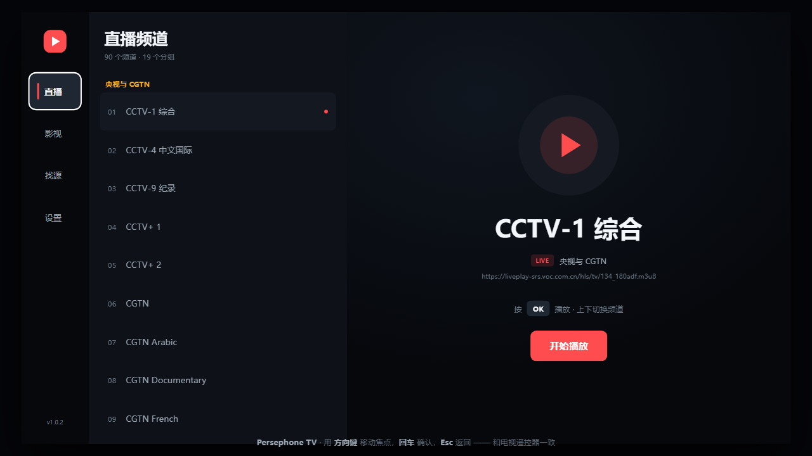
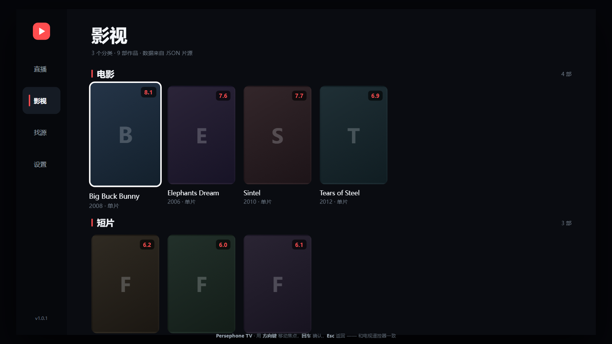
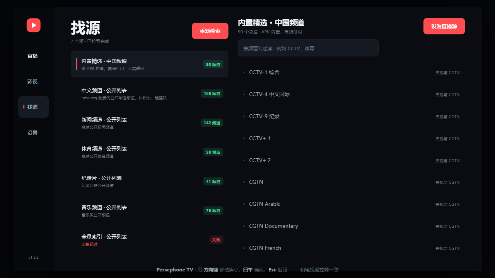
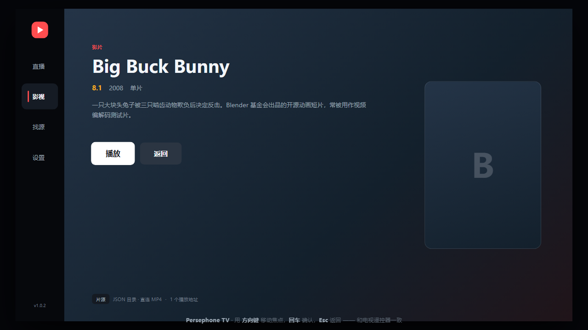
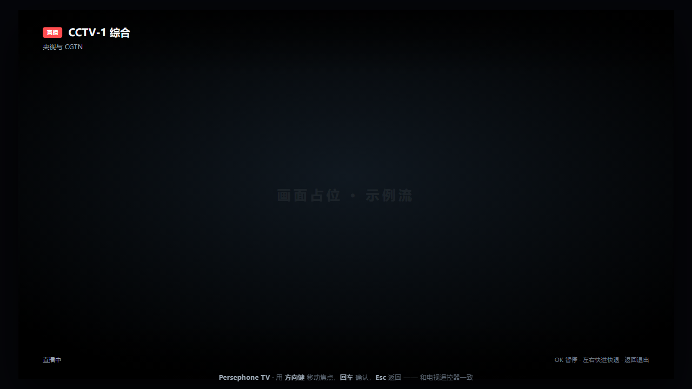
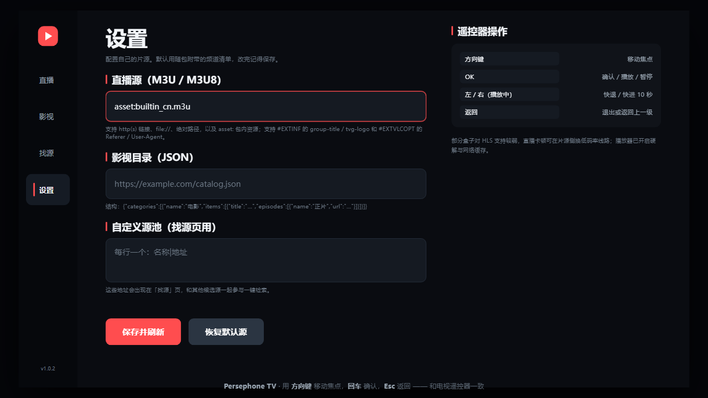

# Persephone TV — Android TV 播放器（Kotlin + Compose + Media3）

[](https://github.com/wknet1988/PersephoneTV/actions/workflows/release.yml)
[](LICENSE)

一个从零搭建的电视端应用：左侧导航栏 + 直播频道列表 + **自动联网找源** + 影视海报墙 + 详情页 + 全屏播放器 + 片源设置。
所有交互围绕**遥控器焦点**设计（放大 + 描边 + 自动滚动），没有触摸依赖。


```
┌──────┬────────────────────────────────────────────┐
│      │                                            │
│ 直播 │   直播：频道分组列表 │ 右侧预览 + 一键播放     │
│ 影视 │   影视：分类海报墙 → 详情页 → 选集播放       │
│ 找源 │   找源：一键联网检索公开源，测速 / 试播 / 导入 │
│ 设置 │   设置：M3U / JSON / 自定义源池，DataStore   │
│      │                                            │
└──────┴────────────────────────────────────────────┘
```

## 先看效果（不用编译）

直接双击打开 `preview.html`：这是一份**用 HTML 复刻的界面预览**，方向键移动焦点、回车确认、Esc 返回，交互逻辑和真机一致，可以先确认视觉与遥控器手感再打包。

| 直播 | 影视 |
| --- | --- |
|  |  |

| 找源 | 详情 |
| --- | --- |
|  |  |

| 播放器 | 设置 |
| --- | --- |
|  |  |

> 截图来自 `preview.html` 的 HTML 复刻版，不是真机运行截图（本机无 Android 编译环境）。

## 功能

- **直播**：解析 M3U / M3U8 播放列表，按 `group-title` 分组，焦点移动即切换右侧预览，OK 键直接起播
- **中英双语台名**：自动把 `CCTV 1` / `Hunan Satellite TV` 这类英文名认成「CCTV-1 综合 / 湖南卫视」，列表里中文一行、英文一行并列
- **音序排序**：分组与组内频道都按音序排——英文按字母、中文按拼音、数字按数值（CCTV-2 在 CCTV-10 前面）
- **影视**：解析 JSON 目录，分类横向海报墙（Coil 加载海报，失败自动降级为渐变占位），详情页含简介、评分、选集
- **播放器**：Media3 ExoPlayer，支持 HLS / MP4，硬解、进度条、缓冲指示、暂停遮罩、错误重试
- **找源**：一键联网检索多个公开频道源，并发拉取 → 解析去重 → 按耗时排序，支持关键词过滤、单频道试播、一键设为直播源
- **设置**：片源地址可改（http(s) / `file://` / 绝对路径），维护自定义源池；DataStore 持久化
- **开箱即用**：内置 6 个公开测试流 + 9 部公开示例片，装上就能点开看

## 频道名与排序

公开索引（iptv-org 之类）里的中文频道大多只写英文名，直接显示对中文用户不友好。App 会在解析 M3U 时自动补上中文名，靠三层策略：

| 层 | 做什么 | 例子 |
| --- | --- | --- |
| 规则 | `CCTV-x` / `XX Satellite TV` / `XX TV` 有规律，批量生成 | `CCTV 5 Plus` → CCTV-5+ 体育赛事<br>`Hunan Satellite TV` → 湖南卫视<br>`Dalian TV` → 大连电视台（城市台不硬算成卫视） |
| 别名表 | 港澳台、特色频道这类没规律的 | `Dragon TV` → 东方卫视<br>`TVB Jade` → 翡翠台<br>`Phoenix InfoNews Channel` → 凤凰卫视资讯台 |
| 去噪重试 | 剥掉画质后缀再试一遍 | `湖南卫视高清` / `TVB Jade [HD]` 都能认出来 |

`tvg-id`（如 `CCTV1.cn`）会作为兜底线索，显示名被改花了也能认出频道。

**认不出来就老实显示原文，不硬猜**——猜错比显示英文更糟。所以冷门地方台如果源里只给英文，仍会保持英文。

排序规则（`NameSort`）：字母/数字开头的排在汉字前面，英文按字母、中文按拼音（系统 ICU 的 zh collation），数字段按数值比较。于是列表读起来是：

```
CCTV-1 综合
CCTV-2 财经
CCTV-13 新闻
安徽卫视
东方卫视
湖南卫视
```

英文名已被中文名包含时（如 `CCTV-1 综合` 里的 `CCTV-1`）不再重复显示第二行。

## 目录结构

```
PersephoneTV/
├── preview.html                     # 浏览器里的界面预览（方向键可操作）
├── docs/                            # 预览截图
├── app/src/main/
│   ├── AndroidManifest.xml          # LEANBACK_LAUNCHER + 横屏 + banner
│   ├── assets/
│   │   ├── demo_live.m3u            # 内置直播源
│   │   └── demo_catalog.json        # 内置影视目录
│   ├── res/drawable-xhdpi/tv_banner.png # 电视桌面横幅（320x180dp）
│   └── java/com/persephone/tv/
│       ├── MainActivity.kt          # 侧边栏 + 页面状态机 + 返回键处理
│       ├── data/
│       │   ├── Models.kt            # Channel / VodItem / PlayTarget / LoadState
│       │   ├── M3uParser.kt         # M3U 解析 + 分组
│       │   ├── CatalogParser.kt     # JSON 目录解析
│       │   ├── ContentRepository.kt # asset / 网络 / 本地文件统一加载
│       │   ├── SourceCatalog.kt     # 内置公开源 + 自定义源池解析
│       │   ├── SourceFinder.kt      # 并发检索 / 测速 / 去重 / 关键词搜索
│       │   └── SettingsStore.kt     # DataStore 配置
│       └── ui/
│           ├── theme/Theme.kt       # 深色配色 + 电视端字号
│           ├── components/          # FocusCard / TvButton / PosterCard / 状态页
│           ├── live/LiveScreen.kt
│           ├── vod/VodScreen.kt
│           ├── finder/FindSourceScreen.kt
│           ├── detail/DetailScreen.kt
│           ├── player/PlayerScreen.kt
│           └── settings/SettingsScreen.kt
├── scripts/build-apk.ps1            # 一键构建（自动找 JDK / SDK / Gradle，缺了才下载）
├── scripts/build-apk.bat            # 双击运行入口
└── gradle/wrapper/gradle-wrapper.properties
```

> 本机工作目录名仍是 `TVAPK`（历史原因），重命名目录不影响构建。

## 编译

**技术栈**：AGP 8.5.2 / Gradle 8.7 / Kotlin 1.9.24 / Compose BOM 2024.06.00 / Media3 1.3.1 / compileSdk 34 / minSdk 21

### 方式一：Android Studio（推荐）

1. Android Studio → Open → 选择本目录
2. 首次同步会按 `gradle/wrapper/gradle-wrapper.properties` 下载 Gradle 8.7；若提示缺少 wrapper jar，按提示让 IDE 生成即可
3. `Run 'app'`，或 `Build → Build Bundle(s)/APK(s) → Build APK(s)`

### 方式二：一键脚本（推荐给没有 Android Studio 的机器）

双击 `scripts\build-apk.bat`，或：

```powershell
powershell -ExecutionPolicy Bypass -File scripts\build-apk.ps1
```

脚本会**先找你已有的工具，找不到才下载**：

| 组件 | 搜索顺序 |
| --- | --- |
| JDK 17~21 | `-JdkPath` → `JAVA_HOME` → 项目下任意含 `bin\java.exe` 的目录 → `.toolchain\` → 下载 |
| Gradle 8.7 | `-GradlePath` → 项目下含 `bin\gradle.bat` 的目录 → `.toolchain\` → 下载 |
| Android SDK | `-SdkPath` → `ANDROID_HOME` → 项目下 `android-sdk\` / `sdk\` → `.toolchain\` → 下载 |

所以：**把 JDK 解压到项目目录下（比如 `jdk-17\`）就会被自动识别**，不用配环境变量。
其余组件缺失时脚本会自己补齐（含 SDK 组件安装与许可协议），最后执行 `assembleDebug`，产物在 `app/build/outputs/apk/debug/`。

> **JDK 版本是有区间的**：Gradle 8.7 只支持 **Java 17 ~ 21**。放了 JDK 27 之类的太新版本会被自动跳过并另下 JDK 17，脚本会明确打印「以下 JDK 版本不兼容，已跳过」。

```powershell
# 指定路径 / 打 release / 走代理
powershell -ExecutionPolicy Bypass -File scripts\build-apk.ps1 -JdkPath D:\jdk-17 -SdkPath D:\Android\Sdk -Release -Proxy http://127.0.0.1:7890
```

> `-Proxy` 只管**工具下载**。Gradle 拉依赖走的是 `gradle.properties` 里的 `systemProp.*.proxy*`（文件里已有注释模板）。

### 只放一个 JDK 够吗？

**不够。** Android 编译至少需要四样东西，缺一不可：

| 组件 | 作用 | 没有会怎样 |
| --- | --- | --- |
| **JDK 17 ~ 21** | 跑 Gradle、Kotlin 编译 | `java: command not found` / `Unsupported class file major version` |
| **Android SDK**（platform-34 + build-tools 34.0.0 + platform-tools） | 提供 `android.jar`、`aapt2`、`d8`、`adb` | `SDK location not found` / `Failed to find target with hash string 'android-34'` |
| **Gradle 8.7+** | 构建系统 | 没有 wrapper jar 时无法启动构建 |
| **网络** | 首次拉 Compose / Media3 等依赖（约 300MB） | `Could not resolve androidx.compose...` |

只想省事的话，直接跑方式二的脚本，它会把这四样凑齐。

### 实测结果

本项目已在本机从零跑通完整链路（没有预装 Android Studio）：

```
==> 定位 JDK（需要 Java 17 ~ 21）
    注意  以下 JDK 版本不兼容，已跳过：H:\AI\TVAPK\jdk-27 (Java 27)
    OK    JDK 17  .toolchain\jdk17
==> 定位 Gradle（需要 8.7+）
    OK    Gradle  .toolchain\gradle-8.7
==> 定位 Android SDK
    OK    SDK     .toolchain\android-sdk
==> 接受 SDK 许可协议
    OK    许可协议已接受
==> 补齐 SDK 组件（platform-tools / android-34 / build-tools 34.0.0）
    OK    SDK 组件就绪
==> 开始构建：gradle assembleDebug
BUILD SUCCESSFUL in 3m 24s
    app-debug.apk  (12.3 MB)
```

`assembleRelease` 同样通过（2m 42s，9.4 MB）。零 Kotlin 警告、零编译错误。

单元测试（`gradle testDebugUnitTest`）覆盖了频道名解析与排序：**18 个用例全通过**，包括
CCTV 各种写法归一、`CCTV-5+` 不被当成 CCTV-5、`CCTV-4K` 不被当成 CCTV-4、画质后缀剥离、
城市台不硬算成卫视、认不出来返回 null、数字按数值排序、中英混排顺序。

```bash
gradle testDebugUnitTest        # 18 passed
```

产物已放在 `dist/`：

| 文件 | 大小 | 说明 |
| --- | --- | --- |
| `PersephoneTV-1.0.1-debug.apk` | 12.4 MB | 带调试信息，装上去看日志用 |
| `PersephoneTV-1.0.1-release.apk` | 9.4 MB | 未配正式签名，暂用 debug 签名，可直接安装 |

APK 清单已校验：`leanback-launchable-activity` 存在、`banner` 存在、`android.hardware.touchscreen` 标记为不需要、声明横屏。即插到电视桌面能被识别成 TV 应用。

### 发版（自动）

打 tag 就会触发 GitHub Actions，自动跑测试 → 构建 debug/release APK → 创建 Release 并把 APK 挂上去：

```bash
git tag v1.0.2
git push origin v1.0.2
```

workflow 在 `.github/workflows/release.yml`，用的是仓库自带的 `GITHUB_TOKEN`，不需要配任何 secret。
也可以去 [Releases](https://github.com/wknet1988/PersephoneTV/releases) 页面直接下载现成的 APK，不用自己编译。

### 方式三：已有完整环境

```bash
gradle assembleDebug        # 或先 gradle wrapper 生成 wrapper，再 ./gradlew assembleDebug
```

## 装到电视 / 盒子

```bash
adb connect 192.168.x.x:5555          # 盒子需在设置里打开「网络调试 / ADB 调试」
adb install -r dist/PersephoneTV-1.0.1-release.apk
```

本机没装 adb 也没关系，脚本已经把 platform-tools 下到 `.toolchain\` 里了：

```powershell
.\.toolchain\android-sdk\platform-tools\adb.exe connect 192.168.x.x:5555
.\.toolchain\android-sdk\platform-tools\adb.exe install -r dist\PersephoneTV-1.0.1-release.apk
```

也可以用 U 盘装：把 apk 拷到 U 盘插电视，用电视上的文件管理器点开安装（需允许「未知来源」）。

电视桌面会出现「Persephone TV」图标（banner 在 `res/drawable-xhdpi/tv_banner.png`，640x360）。

## 遥控器操作

| 按键 | 作用 |
| --- | --- |
| 方向键 | 在侧边栏 / 频道 / 海报 / 按钮之间移动焦点 |
| OK | 确认、播放、暂停 |
| 左 / 右（播放中） | 快退 / 快进 10 秒（直播不可用） |
| 上 / 下（播放中） | 唤出控制条 |
| 返回 | 关闭播放器 → 关闭详情页 → 退出应用 |

## 自动找源（联网检索）

「找源」页进入即自动联网检索，不用手动填地址：

1. **候选源** = 内置公开索引 + 你在设置里维护的自定义源池
2. 并发拉取每个 M3U（`SourceFinder.probeAll`），解析频道、按播放地址去重、记录拉取耗时
3. 左列显示每个源的状态：`检索中` / `N 频道` / `失败原因`；右列展示该源频道
4. 频道可按关键词过滤（如 `CCTV`、`体育`），OK 键直接试播
5. 源条目上按 OK = **设为当前直播源**（写入 DataStore，自动跳到直播页）

内置候选源：

| 源 | 地址 |
| --- | --- |
| 中文频道 | `https://iptv-org.github.io/iptv/countries/cn.m3u` |
| 新闻 / 体育 / 纪录片 / 音乐 | `https://iptv-org.github.io/iptv/categories/*.m3u` |
| 全量索引 | `https://iptv-org.github.io/iptv/index.m3u` |

**边界**：这里只聚合**公开可访问的频道索引**（iptv-org 这类开源公开列表），不内置、不抓取任何盗版或付费频道聚合站。检索结果的可播放性取决于源站状态与你的网络，请自行确认所在地区的相关规定与内容授权。

想加自己的源：设置页「自定义源池」每行写一个 `名称|地址`（只写地址也可以），保存后会一起参与一键检索。

## 片源格式

### 直播（M3U）

```m3u
#EXTM3U
#EXTINF:-1 tvg-logo="https://.../logo.png" group-title="央视",CCTV-1
http://example.com/live/cctv1.m3u8
```

### 影视（JSON）

```json
{
  "categories": [
    {
      "name": "电影",
      "items": [
        {
          "title": "片名",
          "year": "2024",
          "rating": "8.6",
          "poster": "https://.../poster.jpg",
          "desc": "简介",
          "episodes": [
            { "name": "正片", "url": "https://.../movie.mp4" }
          ]
        }
      ]
    }
  ]
}
```

条目没有 `episodes` 时，读取顶层 `url` 作为单集。`poster` / `rating` / `year` / `desc` 都可省略。

## 已知限制

- 源码已通过真实编译（Gradle 8.7 + JDK 17 + AGP 8.5.2，`assembleDebug` / `assembleRelease` 均 BUILD SUCCESSFUL，零警告），并已在真机验证直播、影视、播放、找源、设置五个界面功能正常。
- 中英对照覆盖 **CCTV 全系列 + 全国省级卫视 + 港澳台主流频道 + 常见卡通/体育/影视/教育频道**。冷门地方台、付费频道如果源里只给英文名，会保持英文——不是漏做，是认不出来时不硬猜。要扩表改 `ChannelNames.kt` 里的 `ENTRIES` 即可。
- 只做客户端展示与播放，不内置任何内容源；默认片源是公开测试流（Blender 开源影片 / Apple / Mux 示例流），仅用于验证播放链路。
- 「找源」只保证把公开索引拉下来并解析，**不保证每个频道都能播**——源站下线、地区限制、防盗链都会导致失败，播放器会给出错误码与地址，可换源重试。
- 未做 DRM、字幕、弹幕、投屏、断点续播、收藏历史等进阶功能。

## 后续可以接着做

1. 断点续播（DataStore 存 `url -> position`）
2. 搜索页 + 首字母键盘（TV 端九宫格输入）
3. EPG / 频道台标、多源自动切换失败重试
4. 首页聚合「最近播放 / 收藏」
5. 启动器角标、开机自启、按键自定义

## 免责声明

本项目只做**播放器客户端**，不提供、不托管、不分发任何音视频内容。内置的演示片源均为公开测试流，仅用于验证播放链路。「找源」功能只聚合 iptv-org 这类**公开开源索引**，不内置任何盗版或付费聚合站点。

使用第三方源时的内容合法性由使用者自行判断，请遵守所在地区法律法规。

## License

[MIT](LICENSE)

